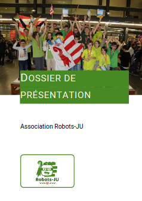
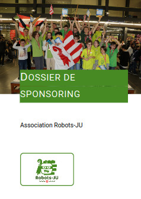

Consultez nos documents de présentation:

[{:class="pdf-thumbnail"}](https://cloud.robots-ju.ch/s/qtHFG677GnTiZfb)

[<i class="fa fa-file"></i> Dossier de présentation (PDF)](https://cloud.robots-ju.ch/s/qtHFG677GnTiZfb)

[{:class="pdf-thumbnail"}](https://cloud.robots-ju.ch/s/RYETsskjXmSiPg4)

[<i class="fa fa-file"></i> Dossier de sponsoring (PDF)](https://cloud.robots-ju.ch/s/RYETsskjXmSiPg4)

<!-- section -->

## Prendre contact

Utilisez le formulaire ci-dessous pour nous contacter au sujet du sponsoring. Nous prendrons ensuite contact avec vous pour en discuter.

<form method="post" action="https://forms.robots-ju.ch/forms/site-sponsoring">
    

        <label for="email">Email (requis)</label>
        <input class="form-control" type="email" name="email" id="email" placeholder="vous@exemple.ch" required>
    

    

        <label for="phone">Téléphone (facultatif)</label>
        <input class="form-control" type="text" name="phone" id="phone" placeholder="0320000000">
    

    

        <label for="level">Domaine (facultatif)</label>
        <select class="form-control" name="level" id="level">
            <option selected>À discuter</option>
            <option>Soutien – Association Robots-JU</option>
            <option>Soutien - Concours</option>
            <option>Autres</option>
        </select>
    

    

        <label for="message">Message (requis)</label>
        <textarea class="form-control" name="message" id="message" required></textarea>
    

    <button class="btn btn-primary" type="submit">Envoyer</button>
</form>
